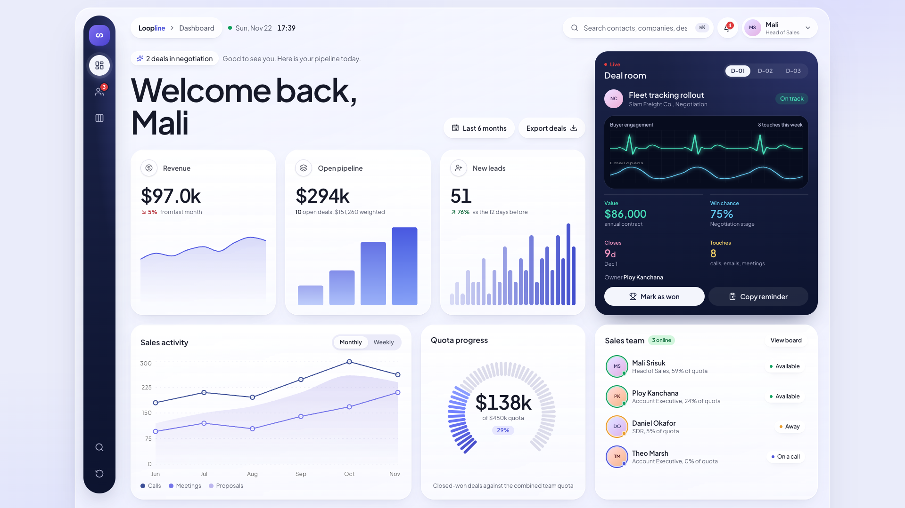
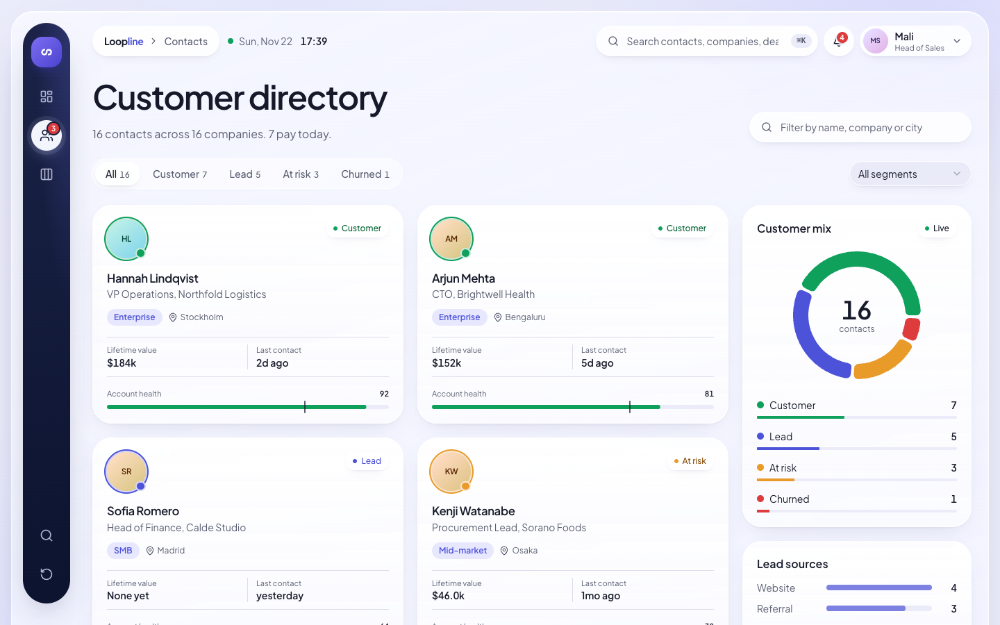
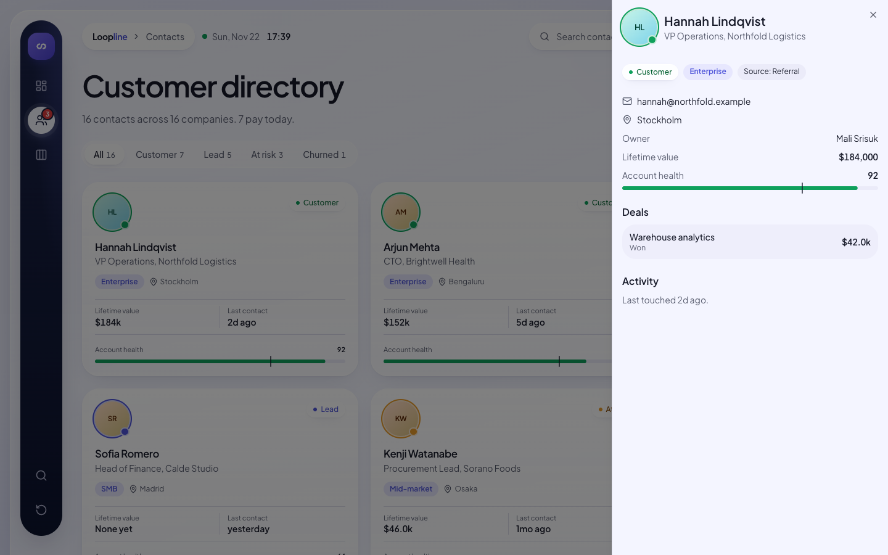
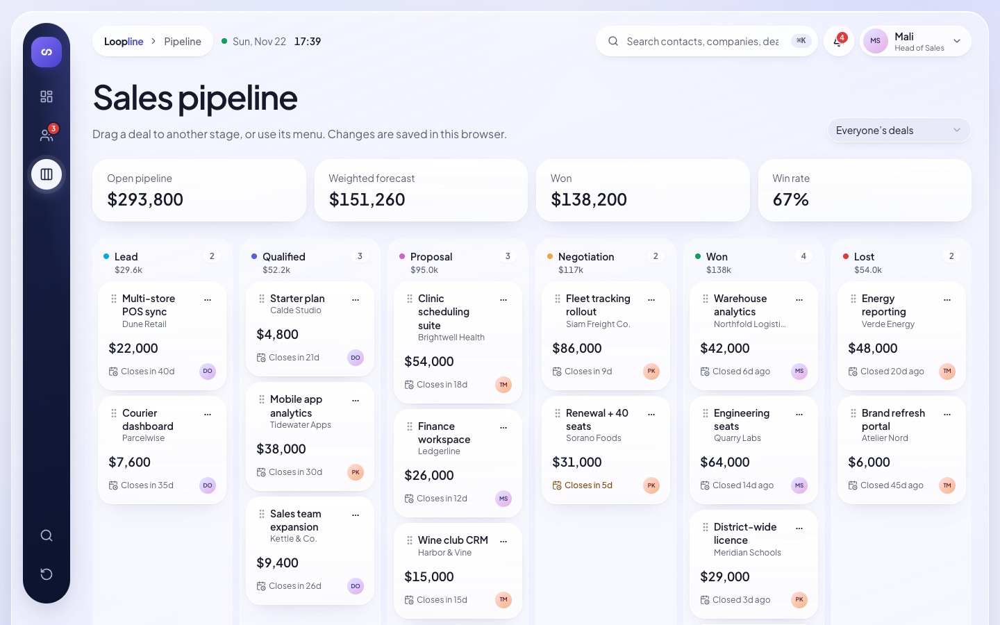
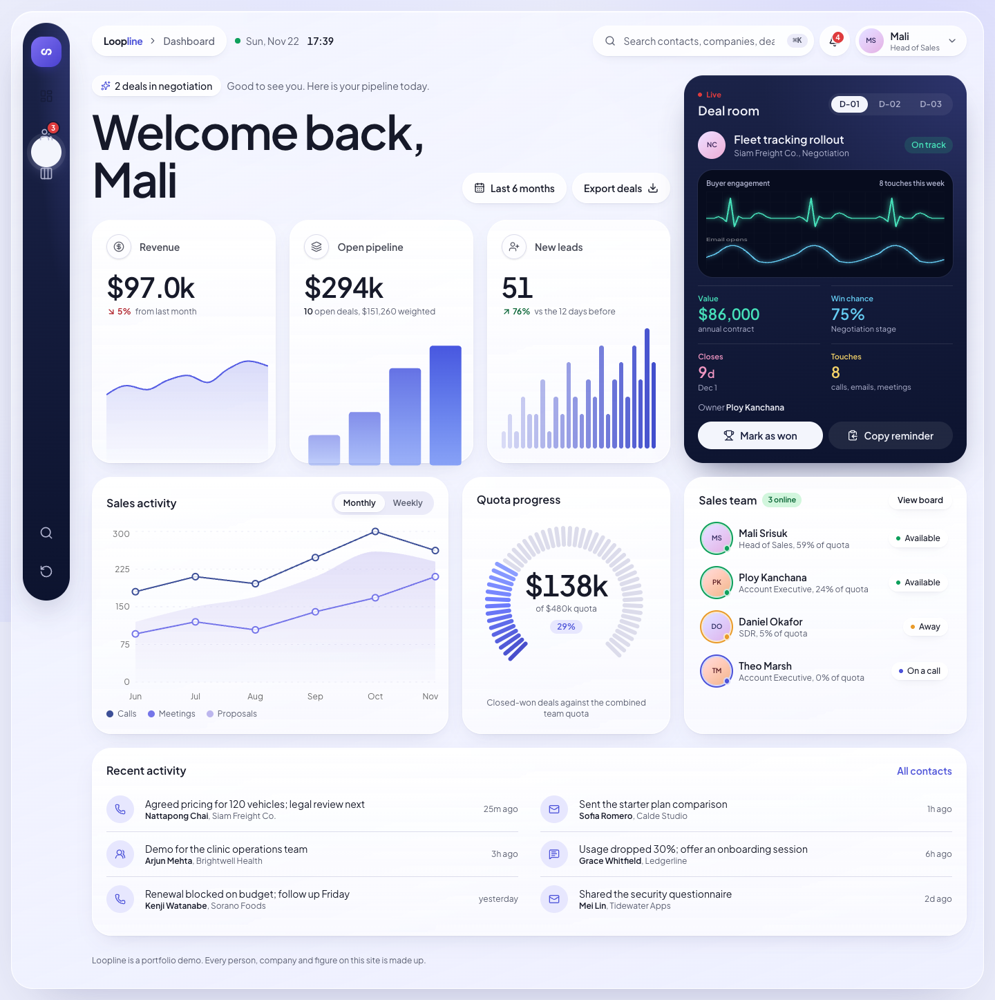
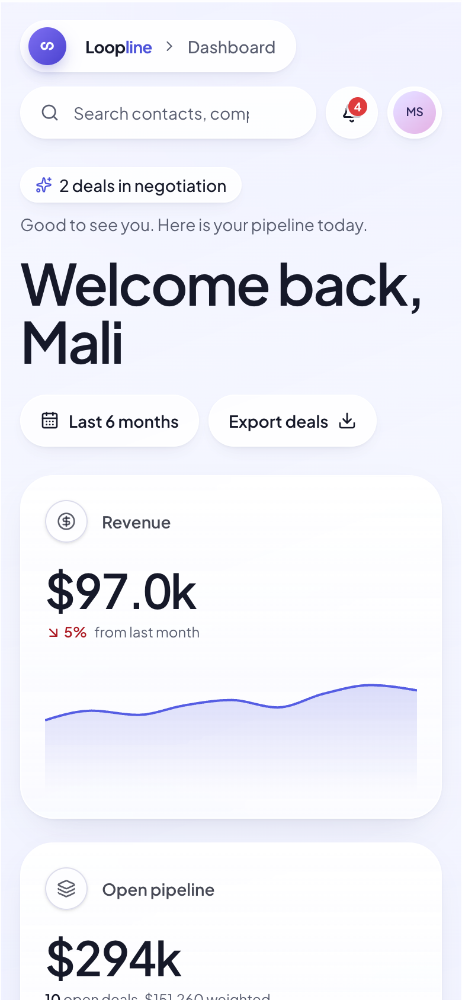
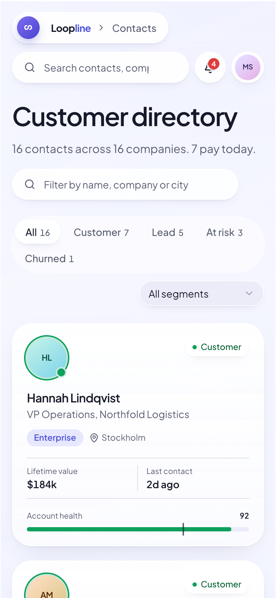

# Loopline: Sales CRM Dashboard (Frontend Demo)

A sales CRM dashboard built for my portfolio. It has no backend: the contacts, deals and activity in `src/data/crm.ts` are made up, and dates are stored as offsets from today so the demo never looks stale.

Live demo: https://loopline-crm-dashboard.vercel.app



Stack: React 19, TypeScript, Vite, Tailwind CSS v4, shadcn/ui (Radix), Recharts, Zustand, React Router

## Pages
- Dashboard: revenue, open pipeline and new-lead cards with charts; a live "deal room" that tracks the three biggest deals closing soon, with a streaming engagement line, colour-coded figures and "Mark as won" with undo; sales activity by month or week; a radial quota gauge; team presence; recent activity. "Export deals" downloads the pipeline as CSV.
- Contacts: a customer directory you can filter by status, segment and text. The filters live in the URL, so a filtered view can be shared as a link. Customer mix and lead source charts sit beside it, and each card opens a drawer with that contact's deals and activity.
- Pipeline: a kanban board across six stages. Drag a deal to another column, or use its menu from the keyboard. Every move can be undone, the totals and win rate update live, and the board is saved in the browser. The rail's reset button restores the demo data.

The search box (⌘K / Ctrl+K) searches contacts from any page. The sidebar slides in on load, and a white disc glides to whichever page is open. On phones the sidebar becomes a bottom bar. If your system is set to reduce motion, the animations stay off.

## Screenshots
| | |
|---|---|
|  |  |
|  |  |

<p>
  
  
</p>

## Run it
```bash
npm install
npm run dev     # http://localhost:5173
npm test        # pipeline maths, deal moves, contact filters, formatting
npm run build   # static output in dist/
npm run capture # retake the screenshots from the live site (needs Google Chrome)
```

The look was inspired by a clinic dashboard concept @paulcodes4 shared on TikTok. The brand, data and layouts here are my own.
